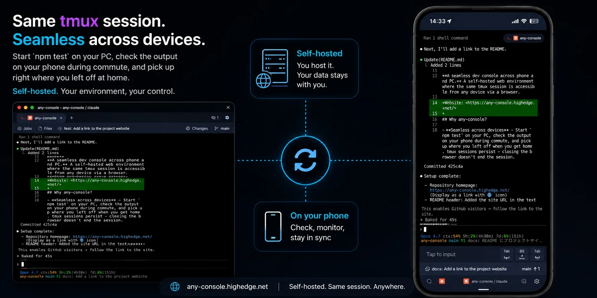

# any-console

[](https://github.com/kt0319/any-console/releases/latest)
[](https://github.com/kt0319/any-console/commits/main)
[](https://github.com/kt0319/any-console/actions/workflows/ci.yml)
[](https://codecov.io/gh/kt0319/any-console)
[](LICENSE)
[](https://www.rust-lang.org/)
[](https://vuejs.org/)

<p align="center">
  
</p>

**A seamless dev console across phone and PC.** A self-hosted web environment where the same tmux session is accessible from any device via a browser.

Website: <https://any-console.highedge.net/>

## Why any-console?

- **Seamless across devices** — Start `npm test` on your PC, check the output on your phone during commute, and pick up where you left off when you get home. tmux sessions persist — closing the browser doesn't end the session.
- **Serious mobile input** — A custom virtual keyboard with flick input. Practical enough to run `git commit` from your phone.
- **Jobs, Git, and terminal in one place** — No tab-switching between tools. Run scripts, commit, and push — all in one tap.

## Features

- **Persistent sessions** — tmux × WebSocket; switch devices without losing your session
- **Mobile-optimized input** — Custom flick keyboard with swipe support
- **Web terminal** — xterm.js based, multi-tab and split-pane
- **Workspaces** — Register repos, group them, and drive files / Git / jobs per workspace
- **Git UI** — Branch switching, commit, push/pull, diff, history, stash, merge/rebase, conflict abort / mark-resolved, worktrees
- **File browser** — Browse, view, upload, and download workspace files
- **Job runner** — One-tap shell script execution; define and edit jobs from the UI
- **Agent state detection** — Sessions running known coding agents show working / idle / blocked state (screen analysis + optional hooks)
- **Push notifications** — Web Push (VAPID) for blocked agents, job phrases, and dispatch approvals
- **GitHub integration** — Issues, PRs, and Actions runs per workspace (via `gh`)
- **Dispatch API** — Queue commands from CI/automation over HTTP, approved from the UI (or run immediately with a restricted direct-scope token)
- **Dev server preview** — Detects listening dev servers and proxies them (TLS-capable)
- **PWA** — Installable on phone and desktop
- **Lightweight stack** — Vue 3 + Pinia frontend (Vite), Rust (axum) backend

## Platform support

**Client side: any OS, any device with a modern browser.** This is the whole point of any-console — open `https://<your-host>/` from your phone, laptop, or any browser and you get the full UI.

**Host (server) side: Linux or macOS.** The runtime is POSIX-portable. Service management is platform-native — `systemd` on Linux, `launchd` on macOS (ideal for an always-on Mac mini) — and `tmux` provides persistent sessions on both. The `./any-console` helper detects the OS and drives the right service manager.

> **macOS note:** an always-on Mac mini / Mac Studio is the sweet spot. The `launchd` service is registered as a user `LaunchAgent`, so it starts at login — enable automatic login (System Settings → Users & Groups) if the Mac runs headless. A MacBook that sleeps or travels is a poor fit for the "check from your phone while away" use case.

## Setup

Downloads a prebuilt release from [GitHub Releases](https://github.com/kt0319/any-console/releases) into `~/.any-console` and runs a non-interactive setup. No Rust/Node toolchain needed — only `git` and `tmux` at runtime:

```bash
curl -fsSL https://raw.githubusercontent.com/kt0319/any-console/main/install.sh | bash
```

Then finish service registration interactively — this registers a systemd (Linux, requires `sudo`) or launchd (macOS) service; the `./any-console` helper detects the OS. Your SSH keys, git/gh config, and shell environment all carry over; tmux sessions persist across reboots:

```bash
cd ~/.any-console && ./any-console setup
```

After this, manage the service with `./any-console start|stop|update|logs|...` (see [Commands](#commands)). To update later, see [Updating](#updating).

### Requirements

- `git` — used by the Git UI
- `tmux` — required for terminal session management
- `curl` / `tar` — used by `install.sh` and `./any-console update` (`install.sh` also needs `sha256sum` or `shasum` for checksum verification)
- `gh` (GitHub CLI, optional) — for fetching GitHub repos, issues, PRs, and Actions

Running from a source checkout (git clone) instead of a binary release additionally requires the build toolchain: Rust (`cargo`) and Node.js (`node` / `npm`).

### macOS: Full Disk Access

macOS shows a one-time permission dialog whenever the server process reads a TCC-protected folder (Desktop, Documents, Downloads, iCloud Drive), and this cannot be suppressed from code. The official way to install on macOS is to grant **Full Disk Access** to the server binary once instead of approving each protected folder individually:

1. System Settings > Privacy & Security > Full Disk Access
2. Click `+` and add the server binary (its path is printed at the end of `./any-console setup`; typically `~/.any-console/any-console-server` for a binary release, or `<repo>/server/target/release/any-console-server` for a source checkout)
3. Toggle it on

`./any-console start`/`restart` re-sign the binary with a fixed identifier (ad-hoc `codesign`, see `codesign_server_binary` in the `any-console` script) before every launch, so this grant should survive rebuilds and updates without needing to be re-added.

## Authentication

> **Read [SECURITY.md](SECURITY.md) before deploying.** any-console gives the browser full shell access to the host — the token must be treated like an SSH key, and the app must never be exposed to the public internet.

- During setup (`install.sh` / `./any-console setup`), if `data/auth.json` does not exist, a random 32-character token is generated, saved, and printed once in the setup output. Open the app URL on your device and sign in with it — the device gets a revocable cookie, so you only enter the token once per device.
- An existing `data/auth.json` is never overwritten.
- The token can be changed from Settings > Auth in the UI.

### Adding a new device with a QR code

Once one device is signed in, you can add another (e.g. add your iPhone from your already-authenticated laptop) without typing the token:

1. On the signed-in device, open Settings > Auth and tap "Add new device" (an "Open on your phone" shortcut is also available in the empty-state Setup checklist).
2. Scan the QR code with the new device's camera app.
3. The new device opens the link, signs in automatically, and lands on the normal app screen.

The QR code encodes a one-time link that expires in 90 seconds and can only be used once — if it expires or was already used, the new device falls back to the normal token entry screen. See [docs/DECISIONS.md](docs/DECISIONS.md) (ADR 28) for the security rationale.

Setting up an iPhone specifically (Tailscale, PWA install, push notifications)? See [docs/IPHONE_QUICKSTART.md](docs/IPHONE_QUICKSTART.md).

### Disabling authentication for local development

Authentication can be disabled with `ANY_CONSOLE_DISABLE_AUTH=1` in the server process environment, or from the UI by turning off "Require token authentication" in Settings > Auth. Both are intended for disposable local development and tests — for normal deployments, keep token + device-cookie authentication enabled.

## Agent hooks (optional)

Terminal sessions running known coding agents (Claude Code, Codex, ...) get automatic
working / idle / blocked state detection out of the box via screen analysis.
For Claude Code you can optionally enable hook-based reporting, which is more
accurate and instant (no polling delay, no dependency on screen rendering).

```bash
./any-console hooks-setup
```

Requires the Claude Code CLI (`claude`) to be installed and on `PATH`.

This registers `scripts/claude-code-hook.sh` in `~/.claude/settings.json`. It
merges into your existing hooks config without touching other hooks, re-running
it is a no-op, and a `.bak` copy of the previous `settings.json` is kept. The
script only acts inside sessions created by any-console and never interferes
with Claude Code itself; if hook reports stop, detection falls back to screen
analysis automatically.

The script ships in both source checkouts and prebuilt release archives
(`scripts/`). If your binary install predates `scripts/` bundling, re-run
the installer once a newer release is available.

## Dispatch API

`POST /dispatch` lets external tools (CI, automation, scripts) launch or send text to a workspace session over HTTP, without opening the UI.

If any-console is only reachable via its `.ts.net` address (the default with Tailscale Serve, see [HTTPS](#https) below), the caller must be on the same tailnet — a hosted CI runner isn't by default. For GitHub Actions, add a step with [`tailscale/github-action`](https://github.com/tailscale/github-action) (OAuth client credentials in Secrets, scoped via a Tailscale ACL tag) before the `curl` step. See `.github/workflows/dispatch-on-ci-failure.yml` for a working example.

```bash
curl -X POST https://<your-device>.ts.net/dispatch \
  -H "Authorization: Bearer <token>" \
  -H "Content-Type: application/json" \
  -d '{
    "workspace": "my-project",
    "job": "terminal",
    "text": "npm run build\n"
  }'
```

By default the request waits in an approval queue — open it from the workspace detail's Dispatch tab, or via a push notification if enabled. Only after a human approves does the text actually get sent. Immediate execution (`"direct": true`) is rejected with 400 for the main token and for dispatch-scope tokens; it is available only to [direct-scope tokens](#direct-scope-tokens).

Key fields on the request body (`server/src/dispatch.rs`):

| Field | Description |
|---|---|
| `workspace` | Workspace ID or display name to target |
| `job` | Job key to launch (default: `terminal`) |
| `text` | Text to send to the session (e.g. a shell command) |
| `branch` | Checkout this branch before running (rejected with 400 if the workspace has uncommitted changes and the branch differs from the current one) |
| `create_branch` / `base_branch` | Create `branch` (from `base_branch`, default: current HEAD) when it does not exist yet, instead of failing |
| `worktree` | Target the git worktree of `workspace` that has this branch checked out, instead of the base checkout |
| `dedup_key` | Opaque string; a new request with the same key replaces the still-pending one instead of queuing a duplicate (useful for repeated CI-failure dispatches) |
| `image_paths` | Server-local file paths (e.g. from `POST /upload-image`); on run, they're appended to `text` as `Image: <path>` lines so CLI agents in the session can read them with their own file tools — they are not sent as binary data |

### API token scopes

**Never put your main token in a crontab, CI secret or script.** Create a scoped token from Settings > Auth > API Tokens (or `POST /api-tokens`). Scoped tokens only work on `POST /dispatch` — every other API, the status-stream WebSocket and `POST /dispatch/{id}/decision` reject them — and can be issued and revoked independently. Both scopes accept an optional `expires_at` (UNIX seconds, must be in the future); once it has passed the token is rejected with 401. Set one on tokens you place in CI secrets or other places outside your machines.

| Credential | `direct` omitted / `false` | `"direct": true` |
|---|---|---|
| Main token / device cookie | Approval queue | 400 |
| `dispatch` scope | Approval queue | 400 |
| `direct` scope | 400 (cannot queue) | Runs immediately if the restrictions below pass |

#### Direct-scope tokens

A direct token starts an agent job immediately, without approval, so a leaked token can run an agent but nothing more than these limits allow. Each request must satisfy all of:

- `job` is required and must be an **agent job**: the job's command must start with a known agent (the executable name must match an agent in `agent_manifests/`, e.g. `claude`; a leading `VAR=value` is allowed). `terminal` and ordinary commands are rejected with 400, because once such a command exits the text would be typed into a shell. Wrapper scripts (`my-agent.sh`, `npx claude`, …) are rejected too.
- `worktree` is required — the job never runs in the main checkout.
- It always starts a **new** session: `session_id` is rejected (400) and existing sessions are never reused.
- The request text is delivered to the agent by the server itself — nobody needs to open the terminal. It is sent once the agent is up and idle; if the agent is not running at that point (it failed to start or has exited back to a shell), the text is **not** typed into the shell, and you get a "not delivered" push notification. The history entry shows `executed` once the session has been launched.
- `dedup_key` is rejected (400); it has no meaning for an immediate run. `branch` / `create_branch` / `base_branch` / `image_paths` are validated like any other dispatch.
- The workspace is within the token's `allowed_workspaces` (403 otherwise).
- The token has runs left today: at most `max_per_day` (default 10, minimum 1) accepted requests per rolling 24 hours (429 otherwise). Failed launches count. The count is kept in the activity log, so it survives restarts. If that log cannot be read or written, the request fails with 500 instead of running without being counted.
- The token has not passed `expires_at` (401 otherwise).

Every run (and every failed launch) sends a push notification with the token name, workspace/worktree and the start of the text, is recorded in the Dispatch history as `executed` / `failed` with `auth: "direct:<token name>"`, and can be re-run from the history with the main token.

```bash
# create a direct token (main token required)
curl -X POST https://<your-device>.ts.net/api-tokens \
  -H "Authorization: Bearer <main-token>" -H "Content-Type: application/json" \
  -d '{"name": "nightly-cron", "scope": "direct", "max_per_day": 4, "allowed_workspaces": ["my-project"], "expires_at": 1893456000}'

# crontab: start the agent every night in a worktree
0 3 * * * curl -fsS -X POST https://<your-device>.ts.net/dispatch -H "Authorization: Bearer $(cat ~/.any-console-direct-token)" -H "Content-Type: application/json" -d '{"workspace": "my-project", "worktree": "auto/nightly", "job": "claude", "text": "Run the test suite and fix flaky tests", "direct": true}'
```

Keep the token in a file readable only by you. Be especially careful before placing a direct token outside your own machines (CI, cloud services): the agent can run commands inside the worktree, so the damage a leaked token can do is bounded by your agent's permission settings (dangerous actions still stop at the agent's own approval prompt and show up as a blocked notification) — workspaces are **not** an OS-level sandbox; everything runs as the same user.

| Status | Meaning |
|---|---|
| `202` | Queued for approval (main token / device / dispatch scope) |
| `200` | Direct run started; body has `dispatch_id` and `session_id` |
| `400` | Restriction violated (see above; including a job that is not an agent), `direct: true` from a credential that may not use it, or the launch failed (the failure is recorded in the history) |
| `500` | The daily-limit log could not be read or written; nothing was started |
| `401` | Invalid, revoked or expired token |
| `403` | Workspace is not in the token's `allowed_workspaces` |
| `429` | The token reached `max_per_day` |

## HTTPS

PWA installation and service workers require HTTPS.

**Tailscale Serve** is the easiest option — it handles certificates automatically:

```bash
tailscale serve --bg http://127.0.0.1:8888
```

Access the app at `https://<your-device>.ts.net/`.

The any-console server itself listens over HTTP. If you need another HTTPS setup, put a reverse proxy such as Caddy or nginx in front of `http://127.0.0.1:8888`.

The default bind address is `0.0.0.0` (all interfaces). When the app is reached exclusively through Tailscale Serve — which proxies to `127.0.0.1` — you can set `__global__.host` to `"127.0.0.1"` in `config.json` so the plain-HTTP port is not also reachable over the LAN.

Direct-port dev server previews can still use HTTPS. `./any-console https-setup` issues a Tailscale certificate and stores it for the preview proxy. The proxy listens on `target port + 20000` (for target ports 1024–9999), so a dev server on port 3000 becomes `https://<device>:23000/` — this works even when the main app is served through Tailscale Serve:

```bash
./any-console https-setup
```

Tailscale certificates expire after ~90 days — re-run the command to renew.

The default port is 8888. To change it, set `__global__.port` in `config.json`.

## Commands

For the systemd (Linux) and launchd (macOS) setups, all operations go through the `./any-console` command, which detects the OS and drives the right service manager.

```
./any-console setup        First-time setup (register service)
./any-console update       Update to the latest release (checksum-verified download)
./any-console start        Start the service          (systemctl / launchctl)
./any-console stop         Stop the service           (systemctl / launchctl)
./any-console restart      Restart the service        (systemctl / launchctl)
./any-console status       Show status (service state, URL, version)
./any-console logs         Show service logs          (journalctl / log file)
./any-console run          Run in foreground (no service; any OS)
./any-console hooks-setup  Register Claude Code hooks for accurate agent state detection
./any-console https-setup  Issue / renew a Tailscale cert for direct-port dev previews
./any-console uninstall    Remove the service registration, optionally clean up files
./any-console version      Show version
```

`run` skips the service manager entirely and starts the server binary directly in the foreground. Useful for WSL or for quick test runs without registering a service.

### Updating

```bash
./any-console update
```

For a binary install, this delegates to `install.sh`: checksum-verified download, atomic binary replacement, and a service restart when one is registered — the same as re-running the `curl | bash` command, and idempotent (`data/`, including `certs/`, and `config.json` are left untouched). For a source checkout, `update` instead fetches the latest release tag and rebuilds (`cargo build --release` + `npm install` + `npm run build`); it refuses to run while the tree has uncommitted changes. Source checkouts can also check for new releases from the UI (Settings > System Info), but applying from there only checks out the latest tag without rebuilding — run `./any-console update` to actually rebuild and restart.

Upgrade compatibility note: legacy-migration code for versions prior to 2026-06 has been removed. When upgrading from such an old version, kill leftover grouped tmux sessions (`acg-*` / `ac-*__c*`) manually if any remain (see `docs/DECISIONS.md`, ADR 16). Automatic `config.json` key conversion from schema versions below 4 (`radial`, `pinned_jobs`, `detached_tab`) has also been removed; such configs are stamped to version 4 and settings stored under those old keys are ignored.

## Repository layout

```
server/            Backend (Rust, axum)
ui/                Frontend (Vue 3 + Pinia, built with Vite)
dist/              Frontend build output, served by the backend (generated by npm run build)
agent_manifests/   Vendored agent-detection manifests (read by the backend at runtime)
tests/             Frontend unit tests (tests/ui), Playwright E2E (tests/e2e), stress tests
scripts/           Helper scripts shipped with releases (e.g. claude-code-hook.sh)
docs/              Architecture & design docs
any-console        Launcher / service-management CLI (install.sh installs alongside it)
```

See [docs/ARCHITECTURE.md](docs/ARCHITECTURE.md) for the module-level breakdown.

## Configuration

- Workspace settings (icons, job definitions, links, etc.) are stored in `config.json`.
- Generated automatically on first run. To configure manually, copy `config.json.example` and edit it.
- Export/import is available from the settings modal.

## Project Stance

any-console started as a tool built for daily real-world use, and it stays close
to that origin: pragmatic, opinionated, and focused on what actually gets used.

- **Issues and PRs are welcome.** Responses may take a while, but they are read.
- **The project has a clear design philosophy** (see `AGENTS.md`). Contributions
  that fit that direction are the easiest to land; ones that pull elsewhere may
  work better as a fork — that is the spirit of MIT.
- **Releases come when they're ready.** A quiet month does not mean the project is
  abandoned.
- **The roadmap is lightweight.** Features land as they prove useful in practice.

If that sounds good to you, welcome aboard.

## License

[MIT](LICENSE)
